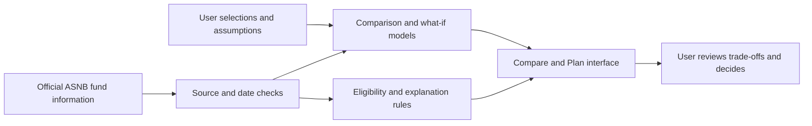

# MyASNB Compare and Plan

A conceptual Decision Support System that explores how clearer fund comparison and savings planning could support new myASNB investors.

**Course:** CSC649 Special Topics in Computer Science  
**Author:** Iman Sufi ([@imansufii](https://github.com/imansufii))  
**Status:** Planning and requirements documentation; no application has been implemented  
**Proposed technology:** Decision Support System (DSS), subject to lecturer approval

## Summary

MyASNB Compare and Plan proposes a single page where a user could compare selected ASNB funds using consistent, source-linked fields and explore an illustrative savings scenario. The concept is intended to organise information and make assumptions visible. It would not choose an investment for the user, execute transactions, or guarantee returns.

## Problem statement

A new myASNB investor who wants to compare funds must consider information such as fund objectives, pricing methods, suitability, risk information, and charges. ASNB publishes this information in official fund and product materials, but a beginner may still find it difficult to compare the differences when information is reviewed separately. This is a design hypothesis grounded in a real decision context, not a claim that a completed user study has proved a usability failure. The project asks whether a simple comparison-and-planning view could make those trade-offs easier to understand without presenting one fund as the best investment.

## Objectives

1. Present selected fund attributes in a consistent side-by-side comparison.
2. Let users explore a savings goal using editable contribution, period, and hypothetical-rate assumptions.
3. Explain eligibility, risk, fees, sources, and missing information in plain language.
4. Keep the decision with the user and clearly separate illustrative output from financial advice.

## Proposed DSS approach

The concept combines published fund information, user inputs, a transparent scenario model, and visible rules. A comparison interface would explain the result while leaving the final decision to the investor.



This independent academic concept is not affiliated with ASNB. A real implementation would require verified current data, appropriate compliance review, and user testing.

## Documentation

- [Problem statement and scope](docs/problem-statement.md)
- [Requirements](docs/requirements.md)
- [User stories and acceptance criteria](docs/user-stories.md)
- [Technology brief](docs/technology-brief.md)
- [Ideation progress](docs/ideation-progress.md)
- [References](docs/references.md)
- [Sprint 1 log](docs/sprint-log.md)

## Repository structure

```text
myasnb-compare-plan/
├── .gitignore
├── README.md
├── docs/
│   ├── ideation-progress.md
│   ├── problem-statement.md
│   ├── references.md
│   ├── requirements.md
│   ├── sprint-log.md
│   ├── technology-brief.md
│   └── user-stories.md
└── src/
    └── README.md
```

## Current status

- [x] Review the CSC649 assignment brief, rubric, Week 2 lab, Week 3 lab, and current report draft.
- [x] Prepare the problem statement, scope, requirements, and user stories.
- [x] Prepare the conceptual DSS explanation, worked example, and Mermaid diagrams.
- [ ] Confirm the DSS topic with the lecturer.
- [ ] Validate the problem hypothesis with an approved observation or credible study.
- [ ] Complete and record the GitHub issues, project board, branches, and pull-request reviews.
- [ ] Replace report placeholders with genuine repository screenshots and links.
- [ ] Complete the required GenAI declaration and independently verify every source before submission.

## Scope and limitations

The repository documents a proposed academic prototype. It does not contain a working myASNB application, real customer data, completed interviews, measured usability results, live fund rankings, or investment advice. See the [problem statement and scope](docs/problem-statement.md) for the full boundary.
