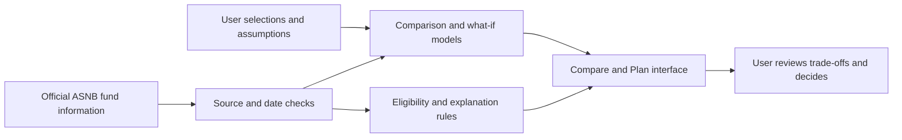

# MyASNB Compare and Plan

A conceptual Decision Support System for comparing published ASNB fund information and exploring an illustrative savings plan.

- **Course:** CSC649 Special Topics in Computer Science
- **Author:** Iman Sufi ([@imansufii](https://github.com/imansufii))
- **Technology:** Decision Support System (DSS), approved by the lecturer
- **Status:** Documentation and planning complete; no application has been implemented

## Summary

MyASNB Compare and Plan proposes a single view where a beginner could compare selected ASNB funds using consistent, source-linked fields and explore an illustrative savings scenario. The system would organise information and make assumptions visible. It would not select an investment, execute transactions, or guarantee returns.

## Problem statement

A beginner using myASNB may need to compare fund objectives, price type, risk information, eligibility, and fees before deciding what to investigate further. ASNB publishes these details, but a new investor may find it difficult to weigh several criteria when reading different fund descriptions. The challenge is not a proven failure of the current application; it is a design question about whether a more direct comparison and planning view would improve understanding. This matters because unclear assumptions or overlooked charges could affect how confidently a person evaluates the alternatives.

## Objectives

1. Present selected fund attributes in a consistent side-by-side comparison.
2. Let users explore a savings goal using editable contribution, period, and hypothetical-rate assumptions.
3. Explain eligibility, risk, fees, sources, and missing information clearly.
4. Keep the decision with the user and clearly separate illustrative output from financial advice.

## DSS approach

The concept combines published fund information, user inputs, a transparent scenario model, and visible rules. A comparison interface would explain the result while leaving the final decision to the investor.



This is an independent academic concept and is not affiliated with ASNB. A real implementation would require current verified data, compliance review, and user testing.

## Documentation

- [Problem statement and scope](docs/problem-statement.md)
- [Requirements](docs/requirements.md)
- [User stories and acceptance criteria](docs/user-stories.md)
- [Technology brief](docs/technology-brief.md)
- [Ideation progress](docs/ideation-progress.md)
- [References](docs/references.md)
- [Sprint 1 log](docs/sprint-log.md)

## Repository structure

```text
myasnb-compare-plan/
├── .gitignore
├── README.md
├── docs/
│   ├── ideation-progress.md
│   ├── problem-statement.md
│   ├── references.md
│   ├── requirements.md
│   ├── sprint-log.md
│   ├── technology-brief.md
│   └── user-stories.md
└── src/
    └── README.md
```
