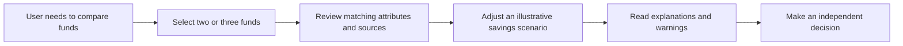

# Ideation Progress

## Design question

How might a beginner compare several ASNB funds without losing track of important details or mistaking an illustrative scenario for a guaranteed outcome?

## Ideas considered

1. A side-by-side fund comparison using matching fields and official source links.
2. A goal-based contribution scenario with editable assumptions.
3. Plain-language explanations for eligibility, risk, fees, and missing information.

## Selected concept

The selected concept, **MyASNB Compare and Plan**, combines the three ideas into one proposed task flow.

## Prototype plan

A future low-fidelity prototype could include fund selection, a comparison table, a scenario panel, and an explanation panel. It would use fictional records for classroom testing and would not request private account information.

## Proposed evaluation

If approved, five beginners could be asked to compare two fictional funds, locate fee information, and change a monthly savings amount. Task completion, time, and points of confusion could be recorded. This evaluation has not been conducted, and no results are claimed.

## Open questions

- Will the lecturer approve DSS as the specialised technology?
- Which official fund fields are necessary for a fair comparison?
- Does the comparison improve understanding compared with a factsheet directory?
- How should hypothetical assumptions be shown to avoid false certainty?
